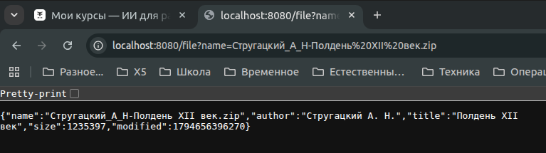

С помощью модели ChatGPT проведен анализ моего проекта 
https://github.com/ravil200606/fileserver
Приступаем к подготовке файлов инструкций для ИИ кодера. Модель/клиент используемые для разработки проекта: Big Pickle/Open Code.

Предлагаю сейчас сделать следующий конкретный шаг: **спроектировать содержание `AGENTS.md`**, но пока не записывать его в архив.

Я бы разбил работу на 4 части:

1. **Контекст проекта** — что такое `fileserver`, как устроен и как его запускать.
2. **Архитектурные и бизнес-правила** — особенно файловая безопасность, `.arch`, ES5/iOS 5.1 и границы `Controller → Service`.
3. **Правила работы AI-агента** — когда задавать вопросы, как строить план, что проверять после изменений.
4. **Три реальных сценария** для домашнего задания:
    - добавление нового endpoint;
    - написание тестов для `BookService`;
    - исправление бага без изменения остального поведения.

Причём я предлагаю сделать инструкции **не слишком длинными**. Для учебной работы будет сильнее показать, что мы выделили действительно важные для этого проекта ограничения, а не просто составили универсальный «AI coding guide».

После этого уже создадим `AGENTS.md`, проведём эксперимент с OpenCode/Big Pickle и на основании реального результата начнём `REPORT.md`.

*Приступай к первой части.*

[AGENTS.md - Project Overview](../AGENTS.md#project-overview)

### Почему я предлагаю именно такой вариант

Здесь есть несколько принципиальных решений.

**1. Мы не перегружаем контекст.**

Например, я сознательно не включил сюда подробное описание каждого метода `BookService`. Это уже будет часть **архитектурных правил**, а не общего контекста.

**2. Мы сразу фиксируем отсутствие БД.**

Для AI это существенная информация: он не должен при задаче «сохранить состояние книги» автоматически предлагать JPA, PostgreSQL и миграции.

**3. `.arch` описан явно.**

Это очень важный термин проекта. AI должен понимать:

```
book.zip
   ↓ archive
book.zip.arch
   ↓ restore
book.zip
```

а не воспринимать `.arch` как настоящий формат архива.

**4. Legacy frontend вынесен прямо в Purpose/Stack/Scenarios.**

Это даст нам потом возможность сделать более жёсткое правило в следующей части:

> Не заменять ES5/`XMLHttpRequest` на современные API без явного требования задачи.

**5. Мы не пишем пока спорные вещи.**

Например, я пока не стал утверждать, что _каждое изменение обязательно требует полного набора integration-тестов_. У проекта сейчас нет существующего набора тестов, поэтому это будет предметом следующей части — **правил AI и verification**.
**Первую часть считаю спроектированной.** Следующая — самая важная: **архитектурные границы и правила, которые AI не должен нарушать**. Именно там мы зафиксируем `BookService`, `findBook()`, `.arch`, ES5/iOS 5.1 и допустимые направления изменений.

*Выполняй следующую часть.*

Переходим к **части 2 — архитектурные границы и правила, которые AI-агент не должен нарушать**.

Я дополнительно сверил актуальную документацию OpenCode: `AGENTS.md` прямо предназначен для архитектурных указаний, соглашений и требований к проверке; при этом OpenCode комбинирует инструкции, а не рассматривает их как безусловную замену системным инструкциям. Поэтому формулировки должны быть **конкретными и проверяемыми**, а не просто «делай правильно».

## Что здесь важно

Я разделю правила на четыре группы:

1. **Архитектурные границы** — кто за что отвечает.
2. **Бизнес-инварианты** — что нельзя сломать.
3. **Совместимость** — прежде всего legacy frontend.
4. **Правила изменения кода** — что AI должен сделать перед изменением потенциально опасной части.

Получается следующий фрагмент `AGENTS.md`

[AGENTS.md - Architecture and Invariants](../AGENTS.md#architecture-and-invariants)

Почему именно эти правила
Здесь, на мой взгляд, получился особенно важный результат для домашнего задания.
1. Мы зафиксировали не «стиль», а реальные свойства системы
   Например:
   findBook() — security boundary.

Это правило непосредственно выведено из существующего кода. Оно не является абстрактной рекомендацией.
2. Мы явно защитили .arch
   Это хороший пример того, как AI может ошибиться.

Если дать ему задачу:
«Добавь возможность архивировать книги»

агент, не зная контекста, вполне способен решить, что нужно использовать ZipOutputStream.

Но в нашем проекте архивирование уже имеет совершенно другое значение — изменение состояния файла через .arch.

Следующая часть — правила поведения самого AI-агента: порядок работы над задачей, обязательный анализ перед изменением, формат ответа, тестирование, работа с неопределённостью и критерии завершённости. Именно там мы начнём превращать AGENTS.md из описания проекта в настоящий рабочий контракт между разработчиком и AI.

*Приступай к следующей части.*

Теперь переходим к части 3 — правила взаимодействия AI-агента с проектом.

Здесь я бы сделал правила достаточно строгими, потому что именно они превращают AGENTS.md из справочника в рабочий контракт. При этом не стоит пытаться заменить ими системные инструкции OpenCode: согласно официальной документации, AGENTS.md добавляется к другим источникам инструкций, а не является абсолютным override. OpenCode
3. Правила работы AI-агента
   Я предлагаю следующие правила. [AGENTS.md - AI Development Workflow](../AGENTS.md#ai-development-workflow)

Почему эти правила важны именно для нашего задания
Здесь появляется несколько механизмов, которые потом можно будет проверить экспериментом с Big Pickle.
1. Запрет на «угадывание» архитектуры
   Например, дадим агенту:
   Добавь возможность удалить книгу из списка.

Без инструкции он может решить, что надо просто добавить новый endpoint и Files.delete().

С нашими правилами агент сначала должен разобраться:
- что такое обычная книга;
- что такое архив;
- где сейчас находится удаление;
- какие ограничения есть у findBook();
- не нарушает ли задача существующую модель безопасности.

Ещё одно важное решение: не требовать тесты абсолютно всегда
Я намеренно написал:
Add or update automated tests when the changed behavior is testable.

а не:
Every change MUST have tests.

Почему?

Потому что для нашего проекта есть, например, изменения CSS или текста README, для которых требование писать Java-тест будет искусственным.

Зато для BookService это уже обязательная практическая рекомендация.

Следующий этап — часть 4: три конкретных сценария. Здесь уже будем не просто описывать правила, а составим реальные задания для Big Pickle: промпт → ожидаемый результат → критерии Done. Это будет непосредственно использоваться и в AGENTS.md, и позже в обязательном REPORT.md.

*Выполни четвертую часть*

Часть 4 — три практических сценария для AI-агента. Здесь уже нужно максимально приблизиться к требованиям задания: для каждого сценария фиксируем задачу → prompt → ожидаемый формат → Done criteria.

Я бы выбрал не абстрактные задания, а такие, которые проверяют разные стороны наших инструкций:
1. Новая функциональность / endpoint — проверяет понимание архитектуры и API.
2. Тестирование — проверяет понимание бизнес-логики и умение создавать тесты.
3. Bugfix без изменения поведения — проверяет соблюдение инвариантов и минимальность изменений.
   Это хорошо согласуется с назначением AGENTS.md в OpenCode: persistent guidance может задавать архитектуру, команды и требования к verification.

# Сценарий: новая функциональность
##   Задача
   Добавить возможность получить информацию о конкретной книге по её имени.

Это естественное расширение существующего API и одновременно хорошая проверка цепочки:
HTTP → Controller → Service → DTO

### Промпт для Big Pickle

Add a new REST endpoint that returns metadata for a single book by its filename.

Requirements:

- Use the existing application architecture.
- The new endpoint must use `Dashboard` as the HTTP layer and `BookService` for business logic.
- Reuse the existing `BookFileDto` if it is appropriate.
- The requested filename must be resolved using the existing filesystem safety rules.
- A request must not allow access to files outside the configured `booksDir`.
- Preserve the existing behavior of all other endpoints.
- Do not introduce a database or new framework.
- Do not change the frontend unless it is necessary for the new endpoint.

Before making changes, provide a short implementation plan.

After making changes, run the relevant tests/build checks.

Return the final result using:
1. Plan
2. Changes
3. Rationale
4. Verification
5. Remaining Issues

#### Что мы ожидаем от агента
Примерно такой ход работы:
изучить Dashboard
↓
изучить BookService
↓
найти существующий findBook()
↓
использовать существующую модель безопасности
↓
добавить endpoint
↓
добавить/изменить тесты
↓
build/test

Особенно важно, чтобы агент не написал отдельную небезопасную логику вроде:
Paths.get(booksDir, name)
в controller.

#### Definition of Done
Задача считается выполненной, если:
- добавлен новый endpoint;
- controller не содержит новой бизнес-логики;
- используется BookService;
- сохраняется защита booksDir;
- существующие endpoint'ы не изменены;
- добавлены соответствующие тесты;
- тесты/сборка реально выполнены;
- нет новых ненужных зависимостей;
- итоговый ответ соответствует требуемому формату.

[OPENCODE_REPORT.md - Сессия первого сценария](OPENCODE_REPORT.md)

Агент Big Pickle отработал как и ожидалось.



# Сценарий: тестирование
  Этот сценарий особенно интересен, поскольку сейчас проект практически не имеет тестов.
  Задача должна заставить AI не просто написать несколько очевидных тестов, а разобраться в поведении BookService.

### Промпт для Big Pickle

Add unit tests for the existing `BookService` without changing production behavior.

Focus on the following existing behavior:

- listing regular book files;
- distinguishing archived files using the `.arch` suffix;
- converting book filenames to author/title metadata;
- rejecting filesystem paths outside `booksDir`;
- archiving books;
- restoring archived books;
- deleting archived books.

Requirements:

- Do not change production code unless a change is strictly required to make the code testable.
- Do not change the existing behavior of `BookService`.
- Tests must verify actual business rules rather than implementation details.
- Include relevant edge cases, especially path traversal attempts and files that do not follow the expected filename convention.
- Use the project's existing test infrastructure and dependencies.
- Do not introduce a new testing framework unless the existing project infrastructure cannot support the required tests.

Before making changes, inspect the existing service implementation and explain the test strategy.

After implementation, run the tests.

Return:
1. Test Plan
2. Tests Added
3. Important Cases Covered
4. Verification
5. Remaining Issues

Definition of Done
- production behavior не изменён;
- создан набор unit-тестов для BookService;
- проверены обычные файлы;
- проверены .arch;
- проверены archive/restore/delete;
- проверены некорректные пути;
- проверены filename edge cases;
- тесты реально запущены;
- все тесты проходят;
- в финальном ответе нет утверждений о непроверенных результатах.

[OPENCODE_REPORT_2.md - Сессия второго сценария](OPENCODE_REPORT_2.md)

Результат работы соответствует ожиданиям.

# Сценарий: исправление бага без изменения поведения
Для третьего сценария я предлагаю взять искусственно сформулированный, но реалистичный bugfix, который заставляет агента исследовать существующий код.

Например:
При передаче одинакового имени книги несколько раз в одной операции результат должен содержать только одну операцию.

Это соответствует уже существующей логике LinkedHashSet.
Задача агента — не «изобрести» новую семантику, а найти и защитить существующую.

### Промпт для Big Pickle

Investigate a possible bug in batch book operations: the same filename may appear more than once in a request.

Determine how the current implementation handles duplicate filenames in archive, restore, and delete operations.

The goal is to ensure that duplicate filenames do not cause the same filesystem operation to be performed more than once.

Important constraints:

- Preserve the existing public API.
- Preserve the existing success/failed result semantics.
- Do not change the meaning of archive, restore, or delete.
- Do not weaken filesystem security checks.
- Do not perform unrelated refactoring.
- If the existing implementation already satisfies the requirement, do not change production code unnecessarily. Add tests that demonstrate the behavior instead.
- If a bug is found, make the smallest appropriate fix.

Before changing code, inspect the relevant implementation and explain whether the suspected bug actually exists.

Add regression tests for the relevant behavior.

Run the tests and report the actual result.

Return:
1. Investigation
2. Plan
3. Changes
4. Rationale
5. Verification
6. Remaining Issues

Здесь есть очень важная проверка. Это уже не просто coding task.
Агент может прийти к выводу, что bug отсутствует. И это правильный результат.

Например, он обнаружит:
new LinkedHashSet<>(names) и скажет:

The suspected duplicate-operation bug is already prevented by the existing implementation.

Тогда правильное действие: не менять production code
+
добавить regression tests
Это очень хорошо проверяет правило:
Do not modify code based only on assumptions.

[OPENCODE_REPORT_3.md - Сессия третьего сценария](OPENCODE_REPORT_3.md)

Работа агента подтверждает изначальное предположение, он не обнаружил дефект и сообщил что дупликации нет.

Таким образом, у нас готовы все четыре проектные части:
1. Контекст проекта.
2. Архитектурные границы и инварианты.
3. Правила взаимодействия AI.
4. Три практических сценария с prompts и Definition of Done.

Сценарии выполнены на агенте-кодере и результаты приложены. Результаты соответствуют нашим ожиданиям на основе файла AGENTS.md