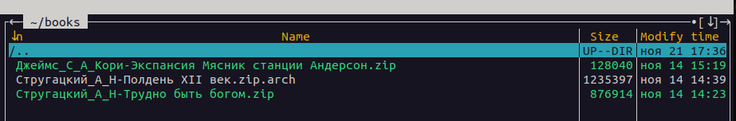
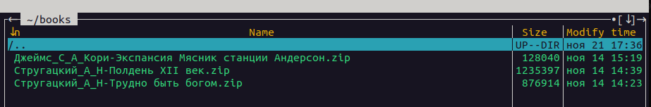

# Отчет по ДЗ №4

Я провожу работу по удобной для себя схеме которую выбрал ранее. ChatGPT выступает консультантом,
модель BigPickle в OpenCode непосредственным исполнителем.

## Сессия с ChatGPT

*Я: Цель работы собрать и запустить минимального AI-агента на LangChain, который выступает в роли обёртки над API на естественном языке;
научиться описывать вызовы API как tool и задавать агенту границы ответственности через системный промпт;
проверить работу агента на наборе пользовательских запросов и зафиксировать реальные вызовы API.
Для работы используй мой проект библиотеки изученный ранее.*

ChatGPT: Да. Для этого задания я бы не создавал отдельный учебный API, а использовал существующий fileserver как API-домен. Это даст гораздо более содержательный эксперимент: Big Pickle будет не просто писать абстрактный LangChain-пример, а строить natural-language интерфейс поверх реально существующего API.

При этом я предлагаю разделить работу на две части:
- ты управляешь процессом и фиксируешь историю эксперимента;
- Big Pickle выполняет реализацию, исправляет ошибки и проводит тесты.
- Я буду готовить для тебя следующие промпты для Big Pickle и анализировать его результаты.
### Как я вижу итоговую архитектуру

   Исходный проект остаётся основой:

                    пользователь
                         │
                         │ естественный язык
                         ▼
                 ┌─────────────────┐
                 │   LangChain     │
                 │     Agent       │
                 │                 │
                 │ System Prompt   │
                 └────────┬────────┘
                          │
                    tool invocation
                          │
                          ▼
                 ┌─────────────────┐
                 │    API Tool     │
                 │ operation=...   │
                 └────────┬────────┘
                          │ HTTP
                          ▼
                 ┌─────────────────┐
                 │   fileserver    │
                 │  Spring Boot    │
                 │      REST API   │
                 └─────────────────┘

### Какие операции взять из fileserver
   Оптимально выбрать 3–4 операции.

    Например:
    Естественный запрос	                API-операция
    «Покажи список книг»	            listBooks
    «Покажи информацию о книге X»	    getBook
    «Архивируй книгу X»	                archiveBook
    «Восстанови книгу X из архива»	    restoreBook
    «Покажи все книги автора»   	    getByAuthor

Но здесь есть важный момент: сначала нужно дать Big Pickle исследовать фактический API проекта.

*Я: Я добавил в проект еще одну точку АПИ getByAuthor с параметром author которая возвращает список книг данного автора. Итого - будет 5 вызовов апи. Планируем шаги выполнения исходя из этого. Теперь зная эндпойнты и требование к LangChain4j можешь выдавать пошагово что мне сделать, какое задание дать Big Pickle и так далее.*

ChatGPT: Да. Теперь, когда у нас есть 5 конкретных API-вызовов и мы решили использовать LangChain4j, можно перейти к нормальному пошаговому плану. Общий план
Наши 5 операций:
1. getAll — получить список всех книг;
2. getByAuthor(author) — получить книги автора;
3. getByName(...) — получить книгу/книги по имени;
4. archive(...) — архивировать книгу;
5. restore(...) — восстановить книгу.
   Точные названия endpoint'ов и параметры не будем придумывать — Big Pickle должен взять их из исходников проекта.

Итоговая схема:

CLI
│
│ естественный язык
▼
LangChain4j AI Service
│
│ LLM выбирает tool + operation
▼
FileserverTool
│
│ HTTP
▼
существующий Fileserver REST API

Первый запрос Big Pickle — только исследование  [OPENCODE_REPORT_1.md - Первый этап](OPENCODE_REPORT_1.md)

Что я предлагаю сделать сейчас
Не давать Big Pickle сразу реализовывать код.

Нам нужен второй этап — утверждение архитектуры.

Причём я бы немного изменил наш предыдущий план: теперь у Big Pickle уже достаточно информации о проекте, поэтому второй запрос должен заставить его сформировать конкретный дизайн, который мы сначала проверим.

Особенно нам надо решить:
1. точные пять операций;
2. сигнатуру одного @Tool;
3. структуру standalone homework_4/ai-agent;
4. LLM provider;
5. response contract;
6. system prompt;
7. CLI;
8. как именно агент будет делать HTTP-вызовы;
9. как логировать реальные tool/API calls.
   И ещё: не надо пока создавать файлы.

### Второй этап утверждение архитектуры и реализация [OPENCODE_REPORT_1.md - Второй этап](OPENCODE_REPORT_1.md#implementation)

После реализации возникла проблема, отсутствие локальной LLM и настроенного провайдера. 
Выполнены попытки найти бесплатных провайдеров, но тоже без успеха [OPENCODE_REPORT_1.md - Поиск открытого провайдера](OPENCODE_REPORT_1.md#Search_for_open_provider)

Для проверки реальной работоспособности я использовал платный доступ через аггрегатор моделей RouterAI и модель gpt-6.2-sol.

LLM_BASE_URL='https://routerai.ru/api/v1'

LLM_API_KEY='МОЙ_КЛЮЧ'

LLM_MODEL='openai/gpt-6.2-sol'

FILESERVER_BASE_URL='http://localhost:8080'

[OPENCODE_REPORT_2.md - Результат прогона с реальной моделью](OPENCODE_REPORT_2.md)

### Проверка реальной работы агента в связке с приложением сервера API

[ByAuthor.log - Получить все книги по автору](ByAuthor.log)

[AllBooks.log - Получить все книги по автору ](AllBooks.log)

[FileMetadata.log - Получить метаданные файла ](FileMetadata.log)

[Archive.log - Архивация книги ](Archive.log)

[Restore.log - Восстановление книги ](Restore.log)

[Delete.log - Попытка удаления книги ](Delete.log)

Логи подтверждают что контракт агента соблюдается. Сам контракт описан тут: [REPORT.md - Контракт агента ](ai-agent/REPORT.md#agent_contract)

